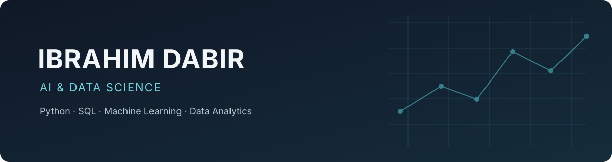

### AI & Data Science | Python · SQL · Machine Learning · Analytics

[LinkedIn](https://www.linkedin.com/in/ibrahim-dabir) · [Email](mailto:ibrahimdabir17@gmail.com)

## About

I'm pursuing a B.Tech in Artificial Intelligence & Data Science at PES Modern College of Engineering, Pune. I'm learning by building projects, working with data, and improving my programming and problem-solving skills.

Currently focused on Python, SQL, data analysis, visualization, and machine learning fundamentals.

## Tools I'm working with

- **Programming:** Python, C++, C
- **Data:** Pandas, NumPy, Matplotlib, Seaborn
- **Databases:** MySQL
- **Analytics:** Power BI, Excel
- **Learning:** scikit-learn, machine learning workflows

## Selected work

- **[EcoMove](https://github.com/ibrahimdabir/eco)** — Sustainable mobility comparison prototype for journeys in Pune.
- **[NEXORA OneClear](https://github.com/ibrahimdabir/nexora-oneclear)** — Compliance-preparation and prioritisation prototype for Maharashtra businesses.
- **[Python course practice](https://github.com/ibrahimdabir/The-Ultimate-Python-Course)** — Exercises and notes from a structured Python course.
- **[MySQL practice](https://github.com/ibrahimdabir/MySql-practice)** — SQL practice, queries, and database concepts.
- **[Matplotlib practice](https://github.com/ibrahimdabir/Matplotlib-Practice)** · **[Seaborn practice](https://github.com/ibrahimdabir/Seaborn-practice)** — Data visualization exercises.
- **[C++ practice](https://github.com/ibrahimdabir/cpp-practice)** — Programming and OOP practice.

## Connect

- LinkedIn: [ibrahim-dabir](https://www.linkedin.com/in/ibrahim-dabir)
- Email: [ibrahimdabir17@gmail.com](mailto:ibrahimdabir17@gmail.com)

